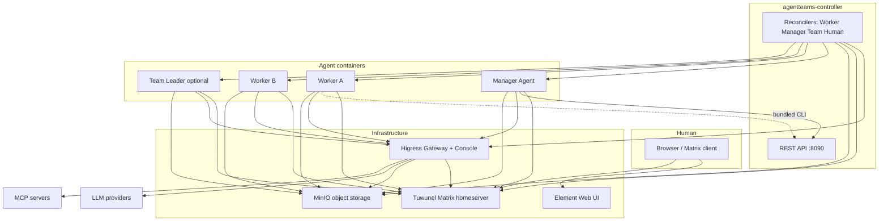

# AgentTeams Architecture

AgentTeams is an **Agent Teams** platform: a **Manager** coordinates **Workers** (and optional **Teams** with a **Team Leader**) while a **Human** participates over **Matrix**. Since **v1.1.0**, the system uses a **multi-container** architecture: infrastructure runs in a **dedicated controller stack** (embedded on a single machine or as separate Kubernetes workloads), while **Manager** and **Worker** images stay **lightweight**—they bundle the agent runtime, `agt` CLI, and skills, but **not** Higress, Tuwunel, MinIO, or Element Web. This document describes the current architecture rather than a historical version snapshot.

---

## Multi-container overview

| Layer | Role | Typical images |
|--------|------|------------------|
| **agentteams-controller** | Go operator: reconciles **Worker**, **Manager**, **Team**, and **Human** CRDs; REST API; worker/manager lifecycle; gateway consumer setup; credential flows when cloud providers are enabled. | `agentteams-controller` (Kubernetes) or **`agentteams-embedded`** (local): Higress all-in-one + **Tuwunel** + **MinIO** + **Element Web** (nginx) + controller binary |
| **Manager** | Coordinates resources and delegates work through Matrix and the Controller API. | Shared `agentteams-harness-openclaw`, `agentteams-harness-qwenpaw`, or another supported Manager Harness; no embedded infrastructure |
| **Worker** | Executes tasks in a container per Worker, with persistent configuration and artifacts in object storage. | `agentteams-harness-{openclaw,qwenpaw,hermes,deepseek,openhuman,codex}`; legacy CoPaw keeps its pinned old image |

The **openclaw-base** image supplies **Ubuntu 24.04**, **Node.js 24**, **OpenClaw**, and **mcporter** for OpenClaw-based Manager/Worker images. It intentionally **does not** ship the old all-in-one Higress bundle; the AI gateway runs in the **controller** (embedded) or as the **Higress Helm subchart** (Kubernetes).

---

## Component relationship

### Mermaid (logical)



### ASCII (deployment shape)

**Local single host (`install/`)** — one **embedded** controller container holds Higress, Tuwunel, MinIO, Element Web, and the controller process; it creates **separate** Manager and Worker containers via the Docker/Podman API:

```
+--------------------------- agentteams-controller (embedded) --------------------------+
|  Higress (:8080/...)   Tuwunel (:6167)   MinIO (:9000)   Element+nginx   controller |
|                              agentteams-controller :8090 (REST)                        |
+-------------------------------+--------------+-------------------------------------+
                                | API / Docker |
              +-----------------+----------------+------------------+
              |                                  |
       agentteams-manager                     agentteams-worker-*
       (lightweight)                      (lightweight)
```

**Kubernetes (`helm/agentteams`)** — each major piece is its own **Pod** (or chart dependency): Higress subchart, Tuwunel StatefulSet, MinIO, Element Web, **controller** Deployment, plus **Manager** and **Worker** Pods created from CRs (no static Manager Deployment when CR-driven install is used).

---

## Two deployment modes

### 1. Local single machine — `install/`

- **`bash <(curl -fsSL https://agentteams.cloud/install.sh)`** pulls the **embedded controller** image (`Dockerfile.embedded`): Higress **all-in-one** base, plus **Tuwunel**, **MinIO**, **mc**, **Element Web**, **`agentteams-controller`**, **`agt`**, and **supervisord** wiring (`supervisord.embedded.conf`).
- The installer starts **`agentteams-controller`**, waits for internal Higress / Tuwunel / MinIO health, then the **ManagerReconciler** creates the **`agentteams-manager`** container (and Workers when you add **Worker** CRs or use the CLI).
- **Manager** uses `AGENTTEAMS_RUNTIME` outside `aliyun`/`k8s`: it waits on **localhost** ports inside the **host** network namespace only where documented—when co-located, the install script maps host ports (e.g. gateway **18080**) into the controller container; the Manager container receives `AGENTTEAMS_CONTROLLER_URL` and optional **Docker socket** for Worker lifecycle.

### 2. Kubernetes — `helm/agentteams`

- **`helm/agentteams/values.yaml`** defines **matrix** (managed Tuwunel), **gateway** (managed Higress or external Alibaba **ai-gateway**), **storage** (managed MinIO or external OSS), optional **credentialProvider**, **controller**, **manager** (bootstrap **Manager** CR), **elementWeb**, **worker** defaults (images for the six current Harnesses and explicitly configured legacy CoPaw).
- The **controller** Pod reconciles CRs against **in-cluster** Matrix, Higress, and MinIO endpoints; **Manager** runs with `AGENTTEAMS_RUNTIME=k8s`, syncing workspace from cluster MinIO via `mc` and consuming credentials injected by the operator.

---

## Communication mechanisms

### Matrix (Tuwunel)

- **Human ↔ Manager ↔ Worker** (and **Team Leader** / team room) use the **Matrix** client-server API.
- Rooms provide **human-in-the-loop** visibility: assignments, progress, and interventions share the same timeline.
- Tuwunel is a **conduwuit**-family homeserver; configuration uses the **`CONDUWUIT_`** environment prefix.

### MinIO (or compatible S3 / OSS)

- **Shared object storage** for worker workspaces (`agents/<name>/…`), **shared** task trees (`shared/tasks/…`), manager paths (`manager/…`), and team-scoped prefixes when using Teams.
- **Manager** and **Workers** use the **`mc`** client (and sync scripts) to mirror or push objects; Workers are designed to be **replaceable** because durable state lives in the bucket.

### Higress — AI Gateway and API Gateway

- **LLM traffic**: OpenAI-compatible routes through Higress with **per-identity consumer** key auth.
- **MCP servers** and optional **HTTP/gRPC exposure** of worker ports are modeled as gateway routes managed during reconciliation.
- **Console** (session-cookie auth) is used for route/consumer/MCP administration; the Manager’s init scripts and skills align with that model.

See the [Higress Gateway API reference](../usage/higress-gateway-api.md) for the complete list
of externally callable endpoints (LLM, MCP, exposed worker ports, bundled services) and
the Console API surface.

---

## Runtime model

### Worker runtimes (`Worker` CR `spec.runtime`)

| Runtime | Stack | Notes |
|---------|--------|--------|
| **openclaw** (Helm default) | Node.js / OpenClaw gateway in **openclaw-base**-derived image | Primary worker path; **mcporter** for MCP tool calls through Higress |
| **copaw** | Python / CoPaw compatibility path | Retained for existing deployments; uses `agentteams-copaw-worker` and the `.copaw/` runtime directory |
| **qwenpaw** | Python / **QwenPaw 2.x** | Current QwenPaw Worker path; uses `agentteams-harness-qwenpaw` and the `.qwenpaw/` runtime directory |
| **hermes** | Python / **`hermes-worker`** | Matrix worker runtime with Hermes policy/config tree under `hermes-worker-agent/` |
| **deepseek-harness** (experimental) | Node.js / **DeepSeek Harness** | Headless DSH Worker; consumes Controller-projected `runtime.yaml`, supports Matrix text/files, and persists room sessions and delivery state to object storage; pinned to a tested DSH release candidate |
| **openhuman** | Rust / OpenHuman | Native Matrix Harness |
| **codex** | Independent Codex Harness | Packaged separately; shared v1.2.7 release image |

The current Worker CRD accepts all seven values above. Helm provides default images for the six current Harnesses, including QwenPaw. Legacy CoPaw requires an explicitly pinned old image. The Controller resolves the runtime and image when creating Pods or containers; the local installer defaults to QwenPaw, while Helm defaults to OpenClaw.

### Manager runtimes

Manager, Leader, and Worker use the same image and entrypoint for each supported Harness. The Controller projects role instructions, credentials, permissions, and `runtime.yaml`; Manager credentials remain distinct from Worker credentials.

The current Manager CRD accepts `openclaw`, `qwenpaw`, `hermes`, `deepseek-harness`, and `openhuman`. `copaw` is a legacy Manager alias for QwenPaw and does not change the standalone CoPaw Worker runtime. Codex is Worker-only at this API boundary.

Helm defaults to OpenClaw and selects the Harness image from `worker.defaultImage` unless `manager.image` is overridden. The local installer defaults to QwenPaw and offers OpenClaw as the alternative. Core v1.2.7 publishes shared Harness images, not dedicated Manager images; local compatibility wrappers remain under `manager/`.

The QwenPaw Manager runs under `/root/manager-workspace`, using the shared Manager prompts and management skills. See the [Manager Guide](../usage/manager-guide.md) and [Kubernetes runtime configuration](../usage/deployment/kubernetes.md#33-manager-runtime).

---

## Declarative resources and `agt` CLI

### CRDs (`agentteams.io/v1beta1`)

1. **Worker** — model, runtime, image, skills, MCP servers, optional **expose** ports, **channelPolicy**, **state** (`Running` / `Sleeping` / `Stopped`), **accessEntries** (cloud credential scoping when provider sidecar is used).
2. **Manager** — model, runtime, image, soul/agents overrides, MCP servers, **config** (heartbeat interval, worker idle timeout, notify channel), **state**, **accessEntries**.
3. **Team** — **Leader** + **Workers** specs, optional **admin**, **peerMentions**, team **channelPolicy**; status aggregates member readiness and rooms (**team room**, **leader DM**, per-member **RoomID** with Manager).
4. **Human** — display name, email, **permissionLevel**, accessible teams/workers; status includes Matrix user, initial password (once), rooms.

### `agt` CLI

The **`agt`** binary is built from **`agentteams-controller`** and copied into **Manager**, **Worker**, and **embedded controller** images. It talks to the controller **REST API** (e.g. create/get workers, teams, humans, managers) and is the primary **operator-facing** tool inside containers and docs examples (`agt get managers default`, etc.).

---

## Skills system

Skills are **agent-facing Markdown** (`SKILL.md`) plus optional `scripts/` and `references/`, loaded from workspace or image paths.

### Manager skills (16)

Under **`manager/agent/skills/`**, each top-level directory is one skill:

1. `channel-management`  
2. `file-sync-management`  
3. `git-delegation-management`  
4. `agentteams-find-worker`
5. `human-management`  
6. `matrix-server-management`  
7. `mcporter`  
8. `mcp-server-management`  
9. `model-switch`  
10. `project-management`  
11. `service-publishing`  
12. `task-coordination`  
13. `task-management`  
14. `team-management`  
15. `worker-management`  
16. `worker-model-switch`  

These are shared by **OpenClaw** and **QwenPaw** Managers (QwenPaw-specific prompt overrides live under `manager/agent/copaw-manager-agent/` but skills stay common).

### Worker skills

- **Per-runtime builtins** — templates under **`manager/agent/worker-agent/`** (OpenClaw), **`copaw-worker-agent/`**, and **`hermes-worker-agent/`** include a small **core** set (e.g. **file-sync**, **mcporter**, **find-skills**, **project-participation**, **task-progress**) materialized into each worker workspace on provision. The DeepSeek Harness adapter materializes the role-allowed subset from `plugins/teamharness/plugin.yaml` into its DSH profile.
- **On-demand / distributable** — **`manager/agent/worker-skills/`** (e.g. **github-operations**, **git-delegation**): after an administrator asks the Manager to install a named skill for a Worker, the Manager verifies and uploads the skill before adding it to `spec.skills`.

### Team Leader skills

Under **`manager/agent/team-leader-agent/skills/`**:

- `communication`
- `file-sharing`
- `mcporter`
- `organization`
- `project-management`
- `task-management`
- `team-coordination`

The older compatibility aliases `team-project-management`, `team-task-coordination`, and `team-task-management` are removed from the built-in template. Existing Team Leader workspaces that already contain those copied skills are not mutated in place; new and upgraded workspaces should use the canonical `project-management`, `task-management`, and `team-coordination` skills.

---

## Security snapshot

- **Higress consumers** use **key-auth** (Bearer) to scope LLM, storage, and MCP routes per Manager/Worker identity.
- **Secrets** (gateway keys, passwords) are generated or injected by the operator/installer; cloud deployments can use a **credential-provider** sidecar for STS-scoped object storage and gateway APIs (`values.yaml` **credentialProvider** block).

---

## Related reading

- **[`docs/quickstart.md`](../quickstart.md)** — end-to-end setup.
- **[`AGENTS.md`](../../AGENTS.md)** — repository map for developers and agents.
