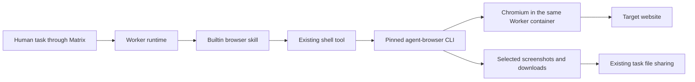

# Worker Browser Automation Proposal

Status: proposed; this document does not implement or validate browser automation.
Feature tracking: [#1569](https://github.com/agentscope-ai/AgentTeams/issues/1569).
[中文方案](../zh-cn/design/worker-browser-automation.md)

## Background and acceptance goal

A Worker should be able to open a website, inspect its rendered page, click,
type, scroll, capture screenshots, and upload/download files after the normal
AgentTeams installation. Users should not need to install a skill or download a
browser inside each new Worker.

The recommended architecture is a pinned `agent-browser` CLI plus a local
Chromium in each supported Worker image, with a builtin discovery skill.
The existing runtime shell tool drives the CLI; the browser runs in that
Worker's container and uses its network.

The first implementation targets QwenPaw, OpenClaw, and Hermes on Docker and
Helm/Kubernetes. Support is a release acceptance target, not a claim about
current images. DeepSeek Harness and OpenHuman need separate image/runtime
validation before advertising support. Legacy CoPaw is not a new-install target.

Host Chrome attachment, a visible desktop, live viewing/manual takeover, and
login-state persistence across container replacement are outside this first
implementation. Related [#1258](https://github.com/agentscope-ai/AgentTeams/issues/1258)
covers the broader local-host Worker use case.

## Verified current architecture

Source baseline: upstream main `7e9a1c73` (2026-11-09 inspection).

| Component | Current behavior | Integration consequence |
| --- | --- | --- |
| [Worker image definitions](../../qwenpaw/Dockerfile) | QwenPaw, OpenClaw base, and Hermes Dockerfiles do not explicitly provision a complete Chromium installation | Runtime packages or native browser-tool names alone do not establish working browser execution |
| [Builtin template selection](../../agentteams-controller/internal/service/builtin_templates.go) and [deployment](../../agentteams-controller/internal/service/deployer.go) | Builtins are selected by role/runtime and materialized into Worker storage; template selection also drives catalog availability | Skill delivery, catalog visibility, and supported runtime selection must stay aligned |
| [Runtime config projection](../../agentteams-controller/internal/service/runtime_config.go) | Managed skill names are projected into runtime config | Builtin browser availability must be added without replacing user assignments |
| [QwenPaw skill application](../../qwenpaw/src/qwenpaw_worker/update.py) | Assigned skills are synchronized, checked for SKILL.md, then refreshed and enabled through the runtime API | Copying a skill into the Manager image is insufficient |
| [Builtin upgrades](../../manager/scripts/init/upgrade-builtins.sh) and runtime file sync | Existing Workers can receive builtin updates; runtime data has its own object-storage synchronization | Browser caches and active profiles must not become normal workspace files |

This is source inspection, not a live check of installed containers. Transitive
runtime dependencies may contain browser libraries; their presence does not
prove that a browser executable and all system libraries are available.

## Options and recommendation

| Option | Benefit | Cost / limitation |
| --- | --- | --- |
| Enable each runtime's native browser tools | Reuses runtime-specific tools | Different installation, configuration, and skill contracts; no common cross-runtime acceptance path |
| Bundle agent-browser + Chromium + discovery skill | One shell-driven workflow across runtimes; no additional service | Larger images and per-active-browser resource use; architecture compatibility needs testing |
| Separate browser service or sidecar | Independent browser lifecycle and optional viewing surface | Adds networking, authentication, session allocation, and deployment lifecycle |

Choose the bundled CLI approach for the first implementation. Do not introduce
a browser cluster, new public API, new CRD, or a paid browser provider.
Existing native tools remain compatible, but this builtin skill teaches the
bundled CLI workflow rather than starting competing browsers for one task.

## Recommended design

### 1. Images and one-click deployment

- Pin the CLI, browser artifact/package, and dependencies after a compatibility
  spike. Record checksums or exact package versions and preserve licenses.
  Do not use floating `latest` or fetch an unpinned skill at Worker startup.
- Install browser libraries and Chinese fonts during image build. Keep browser
  binaries in a fixed image-owned location outside HOME and workspace mounts.
  Configure `AGENT_BROWSER_EXECUTABLE_PATH` for the selected executable.
- Validate amd64 and arm64 separately. The currently inspected upstream
  [Chrome for Testing installer](https://github.com/vercel-labs/agent-browser/blob/main/cli/src/install.rs)
  has no Linux ARM64 download target. Use a tested architecture-specific
  Chromium source, such as the distribution package on Debian, or another
  pinned Chromium artifact; do not silently run an amd64 browser under emulation.
- Update QwenPaw, OpenClaw Worker, and Hermes builds and their release workflow.
  Keep OpenClaw browser dependencies in the Worker layer when possible, so the
  Manager is not enlarged merely to execute Worker browser tasks.
- Ship tested image tags through the existing Docker installer and Helm image
  defaults. A supported fresh installation requires no extra browser command,
  npm/pip download, provider subscription, or browser-related prompt.
  Inventory every image consumer before changing a shared base.
- Headless execution is the default. Do not add Xvfb, VNC, host display mounts,
  privileged containers, or host IPC as installation requirements.

### 2. Builtin skill delivery and runtime activation

Use one maintained discovery skill source, proposed at
`manager/agent/worker-skills/browser-automation/SKILL.md`.
This location currently represents assignable skills; placing a file there
alone does **not** make it builtin.

The implementation must explicitly materialize it for the supported
role/runtime combinations and make it discoverable through the existing
catalog. For template-based runtimes, compose it with the existing builtin
templates; for QwenPaw, add it to the effective managed skill set and use the
existing sync/refresh/enable path. Keep the catalog and deployment using the
same selection rule. Do not duplicate the full upstream manual into every
runtime template or mutate the user's declared skill list.

Treat the browser skill as a runtime builtin separate from package/user skill
assignments: initial enablement happens automatically; unrelated reconciles
must preserve explicit local disablement and existing skills. Reserve the
builtin name and report a same-name package/user collision rather than
silently overwriting user content. Verify package replacement and builtin
upgrade behavior before enabling the default.

Keep the discovery instructions short and in second-person voice. Load the
version-matched command reference from the installed CLI
(`agent-browser skills get core`, if available in the selected pin).
The compatibility spike must verify that command on the actual release;
online documentation may describe a newer CLI.

The skill teaches:

1. Open the requested URL in a task-scoped session.
2. Read an interactive snapshot and act on current element references.
3. After navigation or page changes, read a new snapshot and verify the result.
4. Use screenshot/coordinate interaction when needed; vision-based reasoning
   additionally requires an image-capable model/runtime path.
5. Copy only requested output artifacts into the shared task directory.
6. Close the session on completion or failure; report blockers without claiming
   that a click succeeded.

### 3. Execution, storage, and cleanup

The following are proposed locations, not existing path contracts:

| Data | Proposed location / lifetime |
| --- | --- |
| Browser executable, libraries, fonts, CLI reference | Image-owned paths, outside synchronized HOME |
| Profiles, cookies, caches, sockets, daemon state, temporary downloads | Private per-Worker/task directory under /tmp/agentteams-browser; ephemeral |
| Requested screenshot/download artifacts | Existing task output/shared directory after explicit copy |
| Login-state export | Not enabled by default; no full profile sync to MinIO/OSS |

Use a unique session per Worker and task; one task reuses its session across
shell calls. Named sessions are logical separation, not a security boundary
against processes with the same OS identity. Container and storage permissions
remain the isolation boundary between Workers.

Set all CLI/Chromium runtime directories explicitly with options supported by
the chosen pin, including state that defaults to HOME. Inspect the resulting
filesystem during tests; moving only the Chromium profile is insufficient.
Do not override the runtime's HOME globally. If the chosen CLI cannot keep
sensitive state outside synchronized paths, resolve that before release.

Close sessions after tasks, configure a bounded daemon idle timeout, and clean
up owned browser processes on Worker shutdown. Do not sync active Chromium
profile databases or locks. Container replacement starts with fresh browser
state; a later private persistence design may extend this contract.

### 4. Permissions, failure behavior, and upgrades

The browser uses the Worker's existing network access and tool authorization.
It does not inherit the user's desktop or browser account. Keep debugging and
streaming listeners private; do not publish new host/Ingress ports. Existing
egress restrictions must continue to apply. Web page content cannot authorize
additional tools or changes to Worker permissions.

Verify Chromium sandbox behavior with the real image user and Kubernetes
security context. Prefer an unprivileged sandbox-compatible launch; do not
silently add privilege, host mounts, or a universal sandbox-disabling workaround.
The tested launch policy is a release decision recorded by the image spike.

On missing executable, libraries, launch failure, or timeout, report a browser
capability failure with actionable diagnostics. Do not install a different
version at runtime. Ordinary Worker tasks remain available; browser failure
must not crash the runtime or be reported as task success.

Update the CLI, browser, and discovery skill as a tested set. Refreshing skill
text alone does not upgrade the browser in an old container. Roll back using
the prior image and matching skill version, preserve task outputs, and never
re-enable a locally disabled capability as a side effect of rollback.

## Implementation and validation plan

| Phase | Deliverable | Required evidence |
| --- | --- | --- |
| Compatibility spike | Exact CLI/browser pins, per-architecture installation and launch policy | Native amd64/arm64 container launch with real runtime HOME/mounts/security context; image size, cold start and peak memory measurements |
| Packaging | Worker image layers, dependencies, fonts, release/image references | Launch succeeds without package/browser download; local controlled-page smoke after image pull |
| Skill integration | Shared discovery source, builtin materialization/catalog mapping, QwenPaw activation | New and upgraded Workers discover the skill; QwenPaw API confirms enablement; package/user skills and explicit disablement survive reconciliation |
| Browser workflow | Deterministic local test website and runtime smoke | Navigate, snapshot, click, input, scroll, Chinese screenshot, upload, download, and assertions on actual results |
| Lifecycle and isolation | Session cleanup and private directory configuration | Two concurrent Workers and task sessions do not mix cookies/pages/files; timeout, crash, idle expiry and shutdown release owned processes; no profile/cache objects uploaded |
| Deployment acceptance | Docker and Helm fresh-install and upgrade runs | Test QwenPaw/OpenClaw/Hermes on both architectures; distinguish shell smoke from Matrix task initiated by a real runtime |

Measure /dev/shm usage and memory at representative concurrency before choosing
resource defaults. Browser binaries are preinstalled; browser processes launch
on demand. Retain measured evidence rather than promising a fixed memory budget.

A browser-related test failure blocks advertising that runtime/architecture as
supported. Image build success, CLI --version, or copied SKILL.md are not the
acceptance bar. The implementation PR should include the deterministic
regression/integration tests; this proposal PR makes documentation changes only.

## Decisions to confirm in the compatibility spike

- Exact released CLI/browser pair and native ARM64 artifact source.
- Sandbox-compatible execution identity and measured CPU/memory/shared-memory needs.
- Smallest runtime-specific change that preserves explicit disablement and keeps
  catalog availability consistent with actual image support.

## References

- [agent-browser installation and custom executables](https://agent-browser.dev/installation)
- [Version-matched CLI skills](https://agent-browser.dev/skills)
- [Session model](https://agent-browser.dev/sessions)
- [Configuration](https://agent-browser.dev/configuration)
- [Member runtime config contract](member-runtime-config-contract.md)
- [Existing team skill/catalog/materialization contract](team-skills.md)
