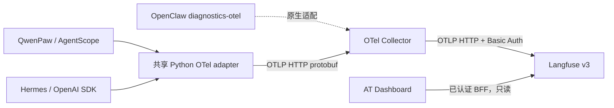

# Worker OpenTelemetry 与 Langfuse / Dashboard 集成

## 一、目标与验收

AT 的不同 Worker 使用标准 OTLP 上报，Collector 负责接收和转发，Langfuse 负责保存与查询，Dashboard 提供统一的 trace 列表、时间线和 span 详情。Worker 不依赖 Langfuse SDK，也不携带 Langfuse 项目密钥。

第一版验收：QwenPaw、Hermes 原生 Agent 执行可以产生包含模型调用的 trace；Dashboard 能按 Worker、运行时、Task ID 和时间筛选，显示 span 父子关系、耗时、模型、用量与错误。配置关闭时保持原启动路径。本文将演示代码和正式接入的边界分开说明。

## 二、源码现状

本方案基于 AT `65d4d7d1` 与 Dashboard `a36dd2a`：

| 接入点 | 当前实现 | 本次处理 |
| --- | --- | --- |
| `qwenpaw/scripts/qwenpaw-worker-entrypoint.sh` | CMS 环境变量生成 LoongSuite bootstrap JSON，镜像已有 OTel 依赖 | 增加通用 OTel 模式；不再要求 CMS 许可字段 |
| `hermes/scripts/hermes-worker-entrypoint.sh` | CMS 开关转换成 OTEL 环境变量；环境变量本身不能证明 SDK 已埋点 | 提供同一份 Python OTel / OpenAI SDK 采集代码 |
| `worker/scripts/worker-entrypoint.sh` | OpenClaw 支持原生 diagnostics-otel，已有插件依赖准备逻辑 | 方案复用原生插件；本次未实现和验证 OpenClaw 适配 |
| `plugins/teamharness/adapters/qwenpaw/task_trace.py` | 已有基于 room context 的任务关联处理器，入口 span 匹配任务 | 保留现有逻辑；通用适配器提供明确 task/room/project 参数，不从进程中随意猜测当前任务 |
| Worker CR `spec.env` | 已可将附加环境变量注入 Worker | 第一版复用现有 API，不新增 tokenUsage 状态字段或 CRD |
| Dashboard | Next.js BFF + 会话/RBAC + 懒加载 section | 新增管理员 Tracing section 与两个只读 API |

仓库历史上还存在 CoPaw 名称和目录；快速适配应以当前镜像实际使用的 SDK 为准，而不是仅以运行时标签判断能否自动埋点。

实测缓存 QwenPaw 2.x 镜像中，现有 `loongsuite-instrumentation-agentscope==0.6.1` 导入时依赖已不存在的 `agentscope._config` 并报错。因此这一版先使用已验证的 OpenAI SDK 埋点，不把镜像已有 LoongSuite 包等同于当前 AgentScope 版本可用的完整框架埋点。

## 三、方案选择

| 方案 | 收益 | 代价与边界 |
| --- | --- | --- |
| 每个运行时直接使用 Langfuse SDK | 单个运行时开发快 | 各语言和运行时分别处理供应商 SDK、密钥、字段和版本 |
| Worker → OTLP → Langfuse | 组件少，可用作个人测试 | 项目密钥分散到每个 Worker；跨运行时归一化和切换后端困难 |
| **Worker → OTel Collector → Langfuse（选用）** | Worker 保持标准协议；集中凭证、队列、后端配置；便于多运行时共用 | 增加 Collector；需要显式定义运行时能采到的层级 |
| 仅在 LLM 网关记录请求 | 无需修改运行时 | 无法覆盖 Agent turn、工具、任务关联和本地失败 |

## 四、推荐架构与实现



### 1. 共享配置和运行时适配

Python 适配器位于 `shared/lib/telemetry/`，由现有 shared build context 进入镜像。开启时公共环境脚本设置 `PYTHONPATH`，Python 的 `sitecustomize` 初始化 OTel SDK，并通过已有的 OpenAI instrumentation 采集同步、异步 SDK 请求。关闭时不加载 OTel 适配器。

```yaml
spec:
  env:
    AGENTTEAMS_OTEL_ENABLED: "true"
    OTEL_EXPORTER_OTLP_ENDPOINT: "http://otel-collector:4318"
    OTEL_EXPORTER_OTLP_PROTOCOL: "http/protobuf"
```

Collector 地址必须能从 Worker 网络访问；本机浏览器使用的 `localhost` 不能直接作为其他容器里的 Collector 地址。镜像构建本身只提供代码与依赖，开启配置后需要重建/重启 Worker 才会应用。

通用模式优先于 QwenPaw/Hermes 入口里的 CMS exporter 配置。原有 CMS 模式在通用模式关闭时继续使用。迁移时应停用旧的 runtime 自动埋点配置，避免同一个 SDK 被两个 instrumentation 重复包装。

### 2. 快速接入更多运行时的契约

| 运行时类型 | 最小适配方式 | 可观察范围 |
| --- | --- | --- |
| Python + OpenAI SDK（QwenPaw、Hermes） | 共用依赖、环境启动和身份处理器 | 自动采集模型 SDK 请求；Agent/工具树需要挂接原生 turn/tool hook |
| 已有 OTel（如 QwenPaw LoongSuite） | 保留原生埋点，将 exporter 指向 Collector；增加身份处理器 | 原生框架所提供的 Agent、工具、模型 spans；需验证重复采集与语义版本 |
| OpenClaw | 配置原生 `diagnostics.otel` 和 Collector 地址 | 原生诊断事件粒度；不能假定与 Python Agent/tool 树完全一致 |
| DeepSeek Harness / OpenHuman | 使用各自 Node/Rust OTel SDK 或原生 hook，发到同一 Collector | 本次未实现；仅设置环境变量不会产生 trace |
| 不使用 OpenAI SDK 的 Python 模型客户端 | 增加该客户端的官方 instrumentation 或封装其模型 hook | 本次不会自动采集 Anthropic/DashScope 自有 SDK |

每个新运行时只负责三个边界：初始化 SDK/原生 exporter，在 turn 入口传入上下文，在原生工具 hook 创建 child span。公共部分负责身份字段、OTLP、Langfuse 映射和 Dashboard。

```python
from at_telemetry import operation

# Place this around your native turn handler, with request-local identifiers.
with operation("worker.turn", task_id=task_id, room_id=room_id, project_id=project_id):
    await native_agent.reply(message)
```

同一异步任务内用 ContextVar 传播身份字段，结束时 reset，防止并发房间串线。后台线程/子进程要显式传递 OTel context。演示脚本用这个三行接入契约包裹真实原生 Agent 循环；正式 Matrix 消息入口的 turn/tool hook 尚需逐运行时接入，不能把演示 wrapper 当成已经覆盖所有线上消息入口。

### 3. 字段、关联和用量

| 字段 | 含义 |
| --- | --- |
| OTel trace_id / span_id / parent_span_id | 标准父子关系，供 Dashboard 瀑布展示 |
| `service.name` | Worker 服务名 |
| `agentteams.worker.name`, `agentteams.runtime` | Worker 与运行时身份 |
| `agentteams.task.id`, `.room.id`, `.project.id` | 从当前请求入口传入的业务关联 |
| `gen_ai.*` / instrumentation 的模型语义字段 | 模型、输入/输出 token、请求错误 |
| `langfuse.user.id`, `.session.id` | Worker 列表过滤与房间关联 |
| `langfuse.trace.tags` | `agentteams`、运行时、`task:<id>`；v3 API 可服务器端过滤 |

AT 字段也映射到 Langfuse metadata，原生 OTel 字段保留。Token 来自模型服务响应中的 usage，缺失则显示未上报；fixture 返回的 token 只能证明协议和展示，不代表真实计费。费用由 Langfuse 对识别的模型计价，未知模型不推算价格。

跨 Worker 的 Matrix 协作默认是多个 trace，使用 task/room/project 关联。完整分布式父子链需要在受控 Matrix 自定义 content 中传递 W3C `traceparent`/`tracestate`，并在接收入口 extract；这一步尚未实现，不把同一 Task ID 伪装成同一 trace。对不可信消息来源的采样与上下文接收规则应由平台入口控制。

### 4. Collector、凭证和失败行为

演示 Collector 开放容器内 4317/4318，通过 OTLP HTTP 将 traces 转发至 Langfuse `/api/public/otel`，由 exporter 自动追加 `/v1/traces`。Langfuse v3 使用项目公私钥 Basic Auth；演示固定本地账号只用于这个 localhost 实例。

Collector 使用 memory_limiter、batch、重试与磁盘发送队列。队列在独立 Docker volume 中，重启 Collector 后可继续处理已接收的队列内容。SDK 进程内队列仍有容量和退出丢失边界，Langfuse 拒绝数据、磁盘满、进程强杀不能承诺无丢失。采集失败不能阻止 Worker 执行业务。

正式环境应在内部网络部署 Collector，并配置入口认证、TLS、租户隔离与密钥轮换；Worker 不应提交可覆盖平台租户身份的任意字段。演示凭证不能复用到正式环境。

### 5. Dashboard 查询与权限

新增控制台 → 治理 → Tracing。服务端通过环境变量保存 Langfuse 地址和密钥：

```dotenv
LANGFUSE_BASE_URL=http://127.0.0.1:13100
LANGFUSE_PUBLIC_KEY=pk-lf-at-local-demo
LANGFUSE_SECRET_KEY=sk-lf-at-local-demo
LANGFUSE_PUBLIC_URL=http://localhost:13100
LANGFUSE_PROJECT_ID=at-workers
```

列表查询 `GET /api/agentteams/traces`，详情查询 `GET /api/agentteams/traces/:traceId`。BFF 固定服务端目的地，不接受浏览器提供 upstream URL，禁止转发重定向，设置请求超时，不向浏览器返回上游错误原文。列表不返回大段输入输出；点击 trace/span 后才读取详情。

项目密钥可读取整个项目，因此第一版仅允许管理员（level 3），隐藏导航的同时在两个服务端接口执行权限判断。团队用户返回 403。在实现基于 Controller 的访问范围校验之前，不向普通用户开放此接口。

## 五、开发与验证

1. 本次交付：共享 Python adapter、两运行时镜像入口、隔离 Langfuse/Collector、本地原生运行时演示、Dashboard 查询与时间线。
2. 自动验证：并发 ContextVar 隔离、span 父子关系、Task 标签、API 管理员权限、目的地固定、路径校验、错误响应脱敏、瀑布时间坐标；Dashboard 类型检查、lint、生产构建。
3. 实际链路验证：运行两种原生 Agent，确认 Collector 收到数据，再轮询 Langfuse 查询 API 校验模型 span 和 usage，最后在 Dashboard 选择 trace 查看。
4. 后续正式接入：将相同 operation 契约挂到真实 Matrix turn/tool hook，复用 QwenPaw 原生 AgentScope spans，补跨进程上下文、OpenClaw/DSH/OpenHuman 的独立运行时验收。不会用本次 Python 演示证明这些尚未实现的能力。
5. 回退：关闭 `AGENTTEAMS_OTEL_ENABLED` 并重启 Worker；Dashboard 未配置 Langfuse 时显示可操作的配置提示；演示栈可 `docker compose down` 停止，保留数据卷。

本地启动与验收脚本见 [`examples/observability/`](../../examples/observability/)。实际版本、测试结果和演示地址在该目录 README 中记录。

## 六、官方依据

- [Langfuse 原生 OpenTelemetry 接入与属性映射](https://langfuse.com/integrations/native/opentelemetry)
- [Langfuse Docker Compose 部署](https://langfuse.com/self-hosting/deployment/docker-compose)
- [Langfuse Headless Initialization](https://langfuse.com/self-hosting/administration/headless-initialization)
- [OpenTelemetry Collector 配置](https://opentelemetry.io/docs/collector/configuration/)
- [OTLP exporter 环境变量](https://opentelemetry.io/docs/languages/sdk-configuration/otlp-exporter/)

本文演示固定 v3 读 API，不直接套用当前 v4 ingestion header / v2 observations 方案；升级时需一起验证写入语义与查询 API。
